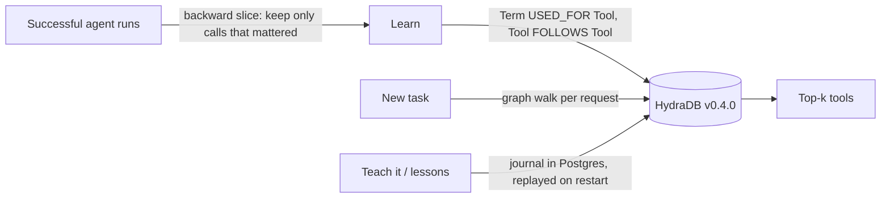

# Desire Path

> Agents shouldn't load every tool. They should follow the trail earlier tasks already wore into the graph.

**Live:** https://desire-path.onrender.com  ·  **No signup needed:** open `/account` and click *Try the demo*  ·  **Walkthrough:** [Loom](LOOM_URL)

Built for the HydraDB hackathon (Nov 14–16, 2026), Track 2: the agent context layer. Learning loop included.

---

## Trailhead: the 30-second version

Most agents paste every tool definition into every prompt. Desire Path learns which tools real tasks used, stores that as weighted edges in **HydraDB**, and finds the tools for a new task by walking the graph. No LLM call, no vector store.

Measured on 10 held-out tasks the graph never learned from (live `/eval`):

| Method | Tools returned | Recall | Precision | All needed found | Est. tokens per call |
|---|---|---|---|---|---|
| Load every tool | all | 1.00 | n/a | 1.00 | ~16,334 |
| **Desire Path (graph)** | **3** | **0.97** | 0.55 | **0.90** | **1,032** |
| Keyword baseline (BM25) | 3 | 0.27 | 0.17 | 0.10 | 1,213 |
| **Desire Path (graph)** | **5** | **0.97** | 0.36 | **0.90** | **1,628** |
| Keyword baseline (BM25) | 5 | 0.30 | 0.12 | 0.20 | 1,925 |

By character count that is about 94% fewer tokens at k=3, and **measured with real agents (next section) the saving is about 89%**. The graph finds 97% of the tools a task needs, against 27% to 30% for keyword search. The live `/eval` reads the shared demo graph, which visitors can change, so its numbers can drift. The frozen, reproducible figures come from the raw traces with no database: `python scripts/offline_eval.py` and `python scripts/audit_numbers.py`.

## Real agent runs (end-to-end)

Gemini agents used real MCP tools on 10 held-out tasks, one run each. Success is checked by code, not by an LLM judge (this is the table on the landing page).

| Tools given to the agent | Passed | Prompt tokens per task | LLM calls per task |
|---|---|---|---|
| All 42 tools, every call | 10/10 | 29,352 | 4.3 |
| Keyword search (BM25), top 5 | 4/10 | 10,835 | 5.9 |
| Keyword search (BM25), top 3 | 2/10 | 5,622 | 6.3 |
| **Desire Path graph, 5 tools (same 42-tool catalog)** | **10/10** | **3,241** | **3.1** |

Same pass rate as loading everything, with about 89% fewer prompt tokens and about 28% fewer LLM calls. Keyword search was offered the same number of tools (5 or 3), failed most tasks, and made more LLM calls (5.9 and 6.3 against 3.1). The 3,241 row is the run on the real 42-tool catalog; the separate 3,239 run used 142 tools (see the scale check). Every row, a per-task pass/fail matrix, and the runs excluded for API errors are in `results/RESULTS.md`, generated from `results/traces.jsonl` by `python scripts/make_results.py`.

**Scale check (partial).** `scripts/scale_test.py` adds N synthetic distractor tools (ids prefixed `synthetic__`) to the real 42. With 100 added (142 tools offered) the graph again passed 10/10 at 3,239 prompt tokens per task. Runs with 300 and 1,000 added tools did not complete because of API errors (0 clean test runs at 300, 1 at 1,000), and loading all tools on the 142-tool catalog never completed, so we report no comparison for those.

## Why "desire path"

A desire path is the dirt track people wear across a lawn along the shortcut they actually want, ignoring the paved route. Agent tooling is still paved in advance: every tool, every prompt. We do the opposite. Let the agent walk, record which tools each successful task needed, and make those trails the map.

## The trail: how it works

```
 task: "read the config file and write a summary"
          |
          v   words (stop-words removed)
   [read] [config] [file] [write] [summary]        <- Term nodes
          |  USED_FOR {count}   weighted, idf-scored
          v
   read_text_file   write_file   list_directory    <- Tool nodes
          |  FOLLOWS {count}    one hop, only strong follow-ups
          v
   top-k tools go into the prompt. Nothing else does.
```



**Graph schema** (all in HydraDB, queried with Cypher over Bolt):
- `(Server)-[:HOSTS]->(Tool)`: the catalog, from four MCP servers (everything, filesystem, memory, thinking).
- `(Term)-[:USED_FOR {count}]->(Tool)`: task words to the tools that were needed.
- `(Tool)-[:FOLLOWS {count}]->(Tool)`: tool B directly after tool A in kept calls.

**Learning** (`scripts/learn_graph.py`): from successful traces on the learn split only, a backward slice keeps a call only if it changed state or its output was later used. Exploration nobody used is dropped, so the graph does not learn detours. Counts are the edge weights.

**Routing** (`scripts/traverse.py`, `Selector` in `learn_graph.py`): fetch each task word's edges, score tools by idf-weighted share of counts, take the top few, follow strong `FOLLOWS` edges one hop, fill to k. If no word is known, it falls back to keyword search and says so.

## Receipts: every claim, and where to check it

| Claim | How to verify |
|---|---|
| About 89% fewer prompt tokens, same pass rate | `results/RESULTS.md` (generated by `python scripts/make_results.py` from `results/traces.jsonl`), also on the landing page |
| Recall 0.97 vs 0.27 (keyword), held-out tasks | Same; offline, no database needed: `python scripts/offline_eval.py`; every figure recomputed from the raw traces by `python scripts/audit_numbers.py` |
| Routing is a real graph walk, no LLM | Read `Selector.select` in `scripts/learn_graph.py` (~40 lines); every `/select` issues Cypher to HydraDB |
| It improves with learning | `results/learning_curve.json`, plotted on the landing page; regenerate with `python scripts/learning_curve.py` (no database needed) |
| It holds up under concurrent load | App → **Benchmark** tab (1, 5, 20 concurrent, cache off); `results/load_ttl*.txt` |
| Lessons survive restarts | Teach, restart the Render service, route again; every lesson is on `/history.html` |
| Private workspaces are private | Sign up two accounts; lessons in one do not change the other |

**Learning curve.** The graph is learned from the 20 successful all-tools agent runs on the learn split. The 10 held-out test tasks are never used for learning (`scripts/learn_graph.py` asserts the two sets do not overlap). The table is the offline check at k=3: for each number of learned runs, the mean over 30 random orders of those runs (`python scripts/learning_curve.py`; no database needed). With nothing learned, routing falls back to keyword search.

| Learned runs | 0 | 2 | 4 | 6 | 8 | 12 | 16 | 20 |
|---|---|---|---|---|---|---|---|---|
| Recall (mean) | 0.27 | 0.31 | 0.47 | 0.59 | 0.70 | 0.85 | 0.92 | 0.97 |
| Recall (lowest to highest order) | 0.27 to 0.27 | 0.10 to 0.48 | 0.25 to 0.68 | 0.43 to 0.77 | 0.48 to 0.85 | 0.67 to 0.97 | 0.82 to 0.97 | 0.97 to 0.97 |
| All needed found (mean) | 0.10 | 0.21 | 0.37 | 0.48 | 0.59 | 0.73 | 0.82 | 0.90 |

## Wrong turns (what did not work, and the limits)

- **Sequence edges added nothing here.** The graph without `FOLLOWS` ties the full graph at k=3 and has slightly better precision at k=5 (0.38 vs 0.36). The word-to-tool edges do the work. We keep `FOLLOWS` in the graph but do not claim it helps on this catalog.
- **A plain store does as well on known workflows.** Leave-one-task-out over all 30 successful runs (learn from 29, test on the one left out), at k=5: the graph, the graph without sequence edges, and a flat lookup of the tools used by the most similar past tasks all score recall 0.97 and all-found 0.97 (`python scripts/family_holdout.py`). We do not claim the graph structure beats a lookup table. What we show is that learning from runs lifts recall from 0.27 to 0.97, and that HydraDB serves the learned graph on every request.
- **New kinds of work are weak.** Leave-one-family-out (learn from nine workflow families, test on the tenth), at k=5: graph recall 0.60 and all-found 0.50, flat lookup 0.55 and 0.40 (30 tasks, so that gap is within noise). Keyword search does better on `move`, where the learned graph has never seen the words.
- **Precision is low.** The router is recall-first: at k=5 it returns extra tools (precision 0.36). The token cost is still about a tenth of loading everything.
- **Small test.** 10 held-out tasks, so one task moves "all found" by 0.10. Treat this as early evidence, not a benchmark.
- **Small end-to-end test.** One run per task on 10 tasks, one model, so one task moves a rate by 10 points. We compared against loading everything and one-shot keyword search only.
- **We tried SelfGraph and dropped it.** SelfGraph connected to our HydraDB v0.4.0, but its writes failed: the node logged that an object-store put mode (`PutMode::Update`) is not implemented for the local-file store we run. So the versioned history (`/history.html`) is our own: every lesson is timestamped in Postgres with what routing returned before and after.
- **Fixed catalog.** Four MCP servers. Bring-your-own catalog is the first thing on the roadmap.
- **Free-tier host.** The demo sleeps when idle (first request can take about a minute) and HydraDB's disk resets on restart; lessons are replayed from Postgres at startup.
- **Shared demo is open.** Lessons taught on the public app change routing for everyone; they are rate-limited (10 per hour per visitor). Private workspaces do not have this issue.
- **Email.** Verification mail goes through a Gmail relay and may land in spam. The demo button needs no email.

## Judge's map

| Criterion | Where to look |
|---|---|
| Right metrics | Recall, precision, all-needed-found and tokens per call, not accuracy alone: Evaluate tab |
| Real improvement + baseline | BM25 keyword baseline and a no-learning start (0.27); `results/learning_curve.json` |
| Does the graph matter? | Learned word-to-tool edges lift recall from ~0.3 to 0.97 and the graph is queried per request. A flat lookup of similar past tasks scores the same on known workflows, and sequence edges did not help (see wrong turns) |
| Holds up under load | Benchmark tab and `results/load_ttl*.txt` |
| Go-to-market | Below |

## Who would pay

Teams running agents against many MCP servers, where tool definitions eat the context window and the bill. Proposed plans (no paying customers yet): **Open source** (free, self-host) · **Team** ($49/month, proposed: hosted graph, usage dashboard, shared learning across agents) · **Enterprise** (private deployment, audit trail, custom catalogs). Early access: fill in the form at https://tally.so/r/gbd2P1. Roadmap: bring-your-own tool catalog, per-user API keys, password reset, billing.

## For agent builders

```bash
curl "https://desire-path.onrender.com/select?k=5&task=read+the+config+file+and+summarize+it"
curl -X POST https://desire-path.onrender.com/learn -H "Content-Type: application/json" \
  -d '{"task":"read the config file and summarize it","tools":["filesystem__read_text_file","filesystem__write_file"]}'
```

Full API: `/docs`. Loop: route, load only those tool definitions, run, then teach the tools the run actually used.

## Run it

**Docker (no path edits):**
```bash
docker build -t desire-path .
docker run -p 8080:8080 desire-path        # http://localhost:8080
```
The image starts HydraDB (`graph-node` + `graph-indexer`, v0.4.0), builds the graph from `data/tools/` and `results/traces.jsonl`, then serves the site and API. Optional environment: `DATABASE_URL` (Postgres: accounts and saved lessons), `MAIL_RELAY_URL`, `MAIL_RELAY_SECRET`, `PUBLIC_URL` (verification email).

**Scripts against a local HydraDB** (the scripts currently expect the author's `~/dp-data` paths; edit them in `scripts/ingest_tools.py` and `connect()` in `scripts/learn_graph.py`):
```bash
pip install -r requirements.txt
python scripts/ingest_tools.py              # servers and tools into HydraDB
python scripts/learn_graph.py               # learn Term and FOLLOWS edges, print offline eval
python scripts/traverse.py                  # routing service on :8099
python scripts/load_test.py                 # concurrent load test
```

## Repo map

```
scripts/   ingest_tools.py  learn_graph.py  traverse.py  run_agent.py
           baseline_bm25.py  load_test.py  ...        offline pipeline and experiments
hosted/    server.py  learn.py  evalrun.py  accounts.py  journal.py  restore_graph.py
           web service, live evaluation, accounts, Postgres journal, startup rebuild
site/      landing, app, docs, history, account pages
data/tools tool definitions from four MCP servers
results/   traces, learning curve, load-test logs
Dockerfile start.sh                                   one container: HydraDB + service
```

## Credits

Not related to [scbrown/desire-path](https://github.com/scbrown/desire-path), a separate command-line tool that records failed tool calls.

Built on the open-source [HydraDB](https://github.com/hydra-db/hydradb) engine (v0.4.0) as the graph database. Tool definitions come from public MCP servers. Hosted on Render, with Neon Postgres for accounts and the lesson journal.
