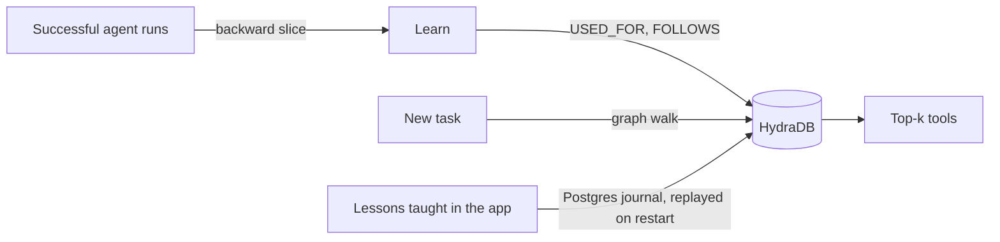

# Desire Path

Pick the few MCP tools an agent needs for a task from a graph learned on earlier successful runs, instead of putting every tool definition in the prompt.

[Live demo](https://desire-path.onrender.com) · [Demo video](https://youtu.be/PtK8uJR-uN4) · [API docs](https://desire-path.onrender.com/docs.html)

The demo runs on a free host, so the first visit can take about a minute to wake. To look around without signing up, open `/account.html` and click **Try the demo**.

Built for the HydraDB hackathon (Nov 14–16, 2026), Track 2: agent context layer. The graph lives in [HydraDB](https://github.com/hydra-db/hydradb) v0.4.0.

## The problem

An agent connected to several MCP servers usually gets every tool definition on every call. With 42 tools that is about 29k prompt tokens per task. Keyword search cuts the cost but often picks the wrong tools, and the agent loops on them.

## How it works

Desire Path records which tools each successful task actually used, and stores two kinds of links in a graph:

- `(Term)-[:USED_FOR {count}]->(Tool)`: words from the task, linked to the tools that were needed.
- `(Tool)-[:FOLLOWS {count}]->(Tool)`: tool B called directly after tool A.

The catalog itself is `(Server)-[:HOSTS]->(Tool)`, built from four MCP servers (everything, filesystem, memory, sequential-thinking). Everything is Cypher over Bolt.

```text
task: "read the config file and write a summary"
        |
        v   words, stop-words removed
 [read] [config] [file] [write] [summary]       Term nodes
        |  USED_FOR {count}, idf-weighted
        v
 read_text_file  write_file  list_directory     Tool nodes
        |  FOLLOWS {count}, one hop, strong edges only
        v
 top-k tools go into the prompt, nothing else does
```



**Learning** (`scripts/learn_graph.py`) uses successful traces from the learning split only. A backward slice keeps a call only if it changed state or its output was used later, so detours the agent abandoned are not learned. Counts become edge weights.

**Routing** (`scripts/traverse.py`, and `Selector` in `scripts/learn_graph.py`) fetches the edges for each task word, scores tools by idf-weighted share of counts, takes the top picks, follows strong `FOLLOWS` edges one hop, and fills up to k. If no word in the task is known it returns `no_confident_match`, and the caller should load the full catalog.

The name: a desire path is the dirt track people wear across a lawn along the shortcut they actually want. Here the trail comes from tasks that already ran, not from a tool list written in advance.

## Results

Gemini agents (`gemini-3.1-flash-lite`) used real MCP tools on 10 held-out tasks. Success is checked in code (answer text, files on disk, memory contents), not by an LLM judge.

| Tools given to the agent | Passed | Prompt tokens per task | LLM calls per task |
| --- | --- | --- | --- |
| All 42 tools, every call | 10/10 | 29,352 | 4.3 |
| Keyword search (BM25), top 5 | 4/10 | 10,835 | 5.9 |
| Keyword search (BM25), top 3 | 2/10 | 5,622 | 6.3 |
| Desire Path graph, 5 tools | 10/10 | 3,241 | 3.1 |

The graph matched the pass rate of loading everything with about 89% fewer prompt tokens and about 28% fewer LLM calls. The table is generated from `results/traces.jsonl` by `python scripts/make_results.py` and written to `results/RESULTS.md`, which also has a per-task pass/fail matrix. Runs that died on API errors are excluded and counted there.

### Retrieval check

This part makes no model calls. For the same 10 held-out tasks, it measures how many of the tools the agent needed were returned. It runs against the live graph (`GET /eval`), so numbers can drift a little because visitors can teach the shared demo.

| k | Method | Recall | Precision | All needed found |
| --- | --- | --- | --- | --- |
| 3 | Graph | 0.97 | 0.55 | 0.90 |
| 3 | Graph without `FOLLOWS` edges | 0.97 | 0.55 | 0.90 |
| 3 | Keyword (BM25) | 0.27 | 0.17 | 0.10 |
| 5 | Graph | 0.97 | 0.36 | 0.90 |
| 5 | Graph without `FOLLOWS` edges | 0.97 | 0.38 | 0.90 |
| 5 | Keyword (BM25) | 0.30 | 0.12 | 0.20 |

### Learning curve

Recall on the held-out tasks at k=3, as more successful runs are learned (mean over 30 random orders of the learning runs). Same method each time, only more runs fed in.

| Runs learned | Recall |
| --- | --- |
| 0 | 0.27 |
| 4 | 0.47 |
| 8 | 0.70 |
| 20 | 0.97 |

With nothing learned, the router behaves like keyword search. Raw numbers are in `results/learning_curve.json`. The learning and test splits do not overlap: `learn_graph.py` asserts this before it learns anything.

### Scale

I padded the catalog with synthetic tools (`results/synth_catalog_100.json`, `_300`, `_1000`). With 100 extra tools alongside the 42 real ones, the graph passed 10/10 at 3,239 prompt tokens per task. The 300 and 1,000 tool runs did not finish because of API quota errors, so there is no result for them. The preload baseline with extra tools never completed either, so there is no comparison.

## Limitations

- **Small test.** 10 held-out tasks, one clean run each, one model, free-tier API. One task moves a rate by 10 points.
- **Same task families.** The test tasks are new instances of the workflow families the graph learned from. On new kinds of work, recall falls to about 0.6.
- **Limited baselines.** Only "load everything" and one-shot keyword search. No agent that can search again, no embedding baseline.
- **The lift comes from learning, not the graph structure.** The learned word-to-tool links do the work (recall from about 0.3 to 0.97). A flat lookup of similar past tasks matches the graph on workflows it has seen. HydraDB serves the learned links live, but this catalog is too small to show a graph beating a flat lookup.
- **`FOLLOWS` edges did not help** on this catalog. Removing them leaves recall unchanged. A graph should matter for multi-hop cases such as prerequisites that the task never names. `scripts/predecessor.py` starts that experiment (output in `results/predecessor.txt`), but the agent-run version (`scripts/run_prereq.py`) did not finish because of API quota.
- **Low precision.** The router favors recall, so at k=5 it returns extra tools. Token cost is still about a tenth of loading everything.
- **Fixed catalog.** Four MCP servers. Bring-your-own catalog is the first roadmap item.
- **Shared demo is open.** Lessons taught on the public app change routing for everyone (limited to 10 per hour per visitor). Private workspaces do not have this problem: they are user-scoped `Term` nodes pointing into the shared `Tool` nodes.
- **Free-tier host.** The demo sleeps when idle and HydraDB's disk resets on restart. Lessons are replayed from a Postgres journal.
- **SelfGraph dropped.** Its writes failed because the local-file object store does not implement `PutMode::Update`. The history page is a Postgres log of every lesson instead.

## Use it

### HTTP API

```bash
# which tools for this task?
curl "https://desire-path.onrender.com/select?k=5&task=read+the+config+file+and+summarize+it"

# teach it which tools a finished task used
curl -X POST https://desire-path.onrender.com/learn \
  -H "Content-Type: application/json" \
  -d '{"task":"read the config file and summarize it","tools":["filesystem__read_text_file","filesystem__write_file"]}'
```

The loop: route, load only those tool definitions, run, then teach the tools the run actually used. Full reference at `/docs.html`.

To estimate what loading your own tools costs, open `/connect.html` (runs in your browser). Export your server's tools with:

```bash
python scripts/export_mcp_tools.py my_tools.json -- <your MCP server command>
```

Hosted per-developer catalogs are not available yet.

### From an MCP client

`scripts/dp_mcp.py` is a small stdio MCP server (Python standard library only). It calls the public API, so by default it talks to the shared demo. Set `DESIRE_PATH_URL` to point at your own deployment.

| Tool | What it does |
| --- | --- |
| `route_tools(task, k)` | Returns the tool ids to load for the task |
| `list_catalog()` | Lists the tool ids Desire Path knows |
| `teach_tools(task, tools)` | Teaches it which tools a finished task used. Off unless `DESIRE_PATH_ALLOW_TEACH=1`, because the demo graph is shared |

Claude Code:

```bash
claude mcp add desire-path -- python3 /path/to/desire-path/scripts/dp_mcp.py
```

Claude Desktop (`claude_desktop_config.json`):

```json
{"mcpServers": {"desire-path": {"command": "python3", "args": ["/path/to/desire-path/scripts/dp_mcp.py"]}}}
```

Status: tested from the command line against a stand-in API, not yet inside a real MCP client. A client still loads its other servers' tool definitions as usual. The saving only happens when the agent calls `route_tools` first and loads just the tools it returns.

## Run it locally

With Docker:

```bash
docker build -t desire-path .
docker run -p 8080:8080 desire-path    # http://localhost:8080
```

The image starts HydraDB (`graph-node` and `graph-indexer`, v0.4.0), builds the graph from `data/tools/` and `results/traces.jsonl`, then serves the site and API. Optional environment variables: `DATABASE_URL` (Postgres, for accounts and saved lessons), `MAIL_RELAY_URL`, `MAIL_RELAY_SECRET`, `PUBLIC_URL`.

Scripts against a local HydraDB:

```bash
pip install -r requirements.txt
python scripts/ingest_tools.py      # servers and tools into HydraDB
python scripts/learn_graph.py       # learn Term and FOLLOWS edges, print offline evaluation
python scripts/traverse.py          # routing service on :8099
python scripts/load_test.py         # concurrent load test
python scripts/make_results.py      # regenerate results/RESULTS.md from the traces
```

The scripts currently expect `~/dp-data` paths. Change them in `scripts/ingest_tools.py` and in `connect()` in `scripts/learn_graph.py`.

## Repo layout

```text
scripts/   ingest_tools.py, learn_graph.py, traverse.py, run_agent.py, run_graph.py,
           make_results.py, load_test.py, baseline_bm25.py, dp_mcp.py
           experiments: scale_test.py, predecessor.py, family_holdout.py, hybrid.py
hosted/    server.py, learn.py, evalrun.py, accounts.py, journal.py, restore_graph.py
site/      landing, app, docs, history and account pages
data/tools tool definitions from the four MCP servers
results/   traces.jsonl, RESULTS.md, learning_curve.json, load tests, raw experiment output
Dockerfile, start.sh    one container: HydraDB plus the service
```

## Cost

Loading 42 tools cost 29,352 prompt tokens per task in these runs, and the graph cut that to 3,241. Over 1,000 tasks that is about 26.1 million fewer input tokens, so the saving is 26.1 × your price per 1M input tokens (in dollars) per 1,000 tasks.

## Roadmap

- Bring-your-own tool catalog
- Per-user API keys and password reset
- A search-again baseline and an embedding baseline
- Verify the MCP server inside a real client

Questions or early access requests: [open an issue](https://github.com/BenCoy09/desire-path/issues).

## Credits

Built on the open-source [HydraDB](https://github.com/hydra-db/hydradb) engine (v0.4.0). Tool definitions come from public MCP servers. Hosted on Render, with Neon Postgres for accounts and the lesson journal.

## License

MIT
